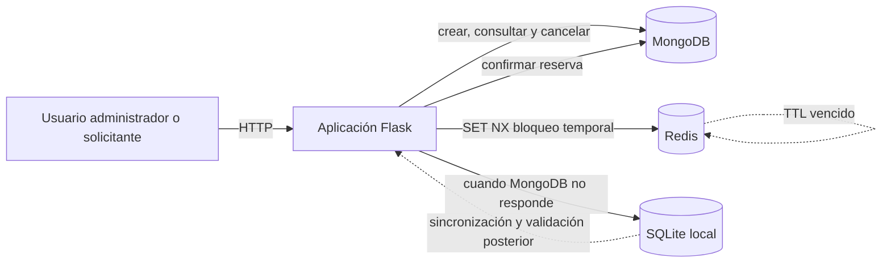

# Arquitectura de UNAreserva

## Propósito y alcance

UNAreserva permite a universidades, bibliotecas, centros comunales y espacios de
coworking administrar recursos compartidos y sus reservas. El MVP permite crear
recursos, consultar disponibilidad, crear o cancelar una reserva y consultar las
reservas del día.

La prioridad de la arquitectura es evitar que dos solicitudes simultáneas confirmen
el mismo recurso en un intervalo de tiempo que se traslapa.

## Diagrama de arquitectura

## Responsabilidad de cada componente

| Componente | Responsabilidad | Datos que administra |
|---|---|---|
| Aplicación Flask | Expone las operaciones del MVP, valida datos, coordina el bloqueo y decide si una solicitud queda confirmada o pendiente. | Solicitudes HTTP y reglas de negocio. |
| MongoDB | Fuente de verdad de la operación. | Recursos, reservas y su historial de estado. |
| Redis | Reduce conflictos durante reservas simultáneas mediante bloqueos breves y, posteriormente, caché de disponibilidad. | Llaves temporales de bloqueo y respuestas de disponibilidad en caché. |
| SQLite local | Conserva una solicitud cuando el motor principal no está disponible. No confirma reservas. | Solicitudes pendientes de sincronización, reintentos y errores. |

## Flujo para crear una reserva

1. La aplicación valida que el recurso exista, que las fechas sean válidas y que
   `fecha_inicio` sea menor que `fecha_fin`.
2. Intenta crear en Redis la llave
   `grupoX:unareserva:bloqueo:<recurso_id>:<YYYY-MM-DD>` con `SET NX EX 15`.
   Si la llave existe, responde que el recurso está siendo procesado y solicita
   reintentar; no crea una reserva.
3. Con el bloqueo adquirido, consulta MongoDB en busca de reservas activas del
   mismo recurso que se traslapen. Dos intervalos se traslapan cuando
   `inicio_existente < fecha_fin_nueva` y `fin_existente > fecha_inicio_nueva`.
4. Si no hay conflicto, inserta la reserva con estado `activa` en MongoDB y
   elimina o deja vencer el bloqueo. Si existe conflicto, responde `409 Conflict`.
5. Si MongoDB no responde, registra la solicitud en SQLite con estado `pendiente`.
   La respuesta aclara que la reserva **no está confirmada**. Al sincronizar, se
   repite la validación contra MongoDB antes de crearla.

Este diseño mantiene a MongoDB como fuente de verdad: Redis evita carreras, pero
un fallo o vencimiento de Redis nunca convierte una solicitud en una reserva sin
la validación final en MongoDB.

## Disponibilidad y consistencia

La consulta de disponibilidad lee las reservas activas de MongoDB para el recurso
y periodo solicitados. Más adelante se podrá guardar esa respuesta en Redis con la
llave `grupoX:unareserva:disponibilidad:<recurso_id>:<fecha>` y TTL de 60 segundos.
Toda creación o cancelación invalida esa llave. Si Redis falla, la aplicación lee
MongoDB directamente; si MongoDB falla, no informa disponibilidad como confirmada.

## Medición prevista

- Mediana de tiempo de consulta de disponibilidad: con y sin caché Redis.
- Mediana de tiempo de creación de reserva bajo solicitudes simultáneas.
- Número de reservas conflictivas confirmadas: el valor esperado es cero.
- Cantidad y resultado de solicitudes recuperadas desde SQLite.
