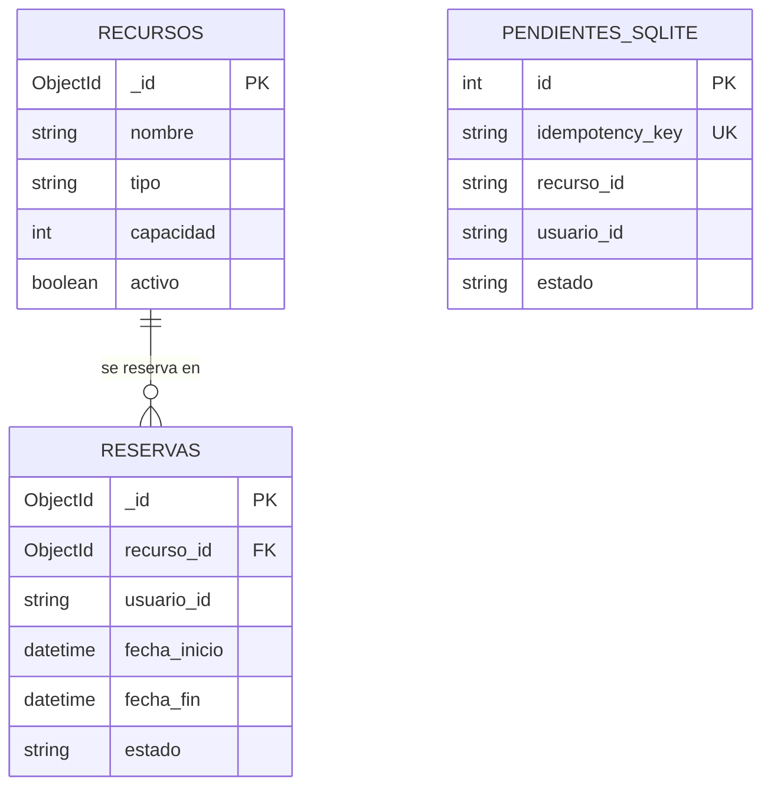

# Modelo de datos

## Decisiones de diseño

- **MongoDB es la fuente de verdad.** `reservas` referencia a `recursos` mediante
  `recurso_id`; no se embeben reservas dentro del recurso porque una reserva tiene
  ciclo de vida propio, se consulta por día y debe conservar su historial.
- **Redis no guarda datos permanentes.** Sus llaves solo coordinan solicitudes en
  curso y aceleran consultas que pueden recalcularse desde MongoDB.
- **SQLite conserva trabajo pendiente.** Una fila local no significa una reserva
  confirmada; al sincronizarse debe volver a validarse contra MongoDB.

## MongoDB

### Colección `recursos`

```json
{
  "_id": "ObjectId",
  "nombre": "Sala de estudio 101",
  "tipo": "sala",
  "capacidad": 8,
  "ubicacion": "Biblioteca central, piso 1",
  "horario": { "apertura": "07:00", "cierre": "21:00" },
  "activo": true,
  "creado_en": "ISODate"
}
```

### Colección `reservas`

```json
{
  "_id": "ObjectId",
  "recurso_id": "ObjectId de recursos",
  "usuario_id": "usuario-demo-001",
  "fecha_inicio": "ISODate",
  "fecha_fin": "ISODate",
  "estado": "activa | cancelada",
  "creado_en": "ISODate",
  "cancelado_en": "ISODate o null",
  "origen": "web | sincronizacion_sqlite",
  "idempotency_key": "UUID"
}
```

La cancelación cambia el estado y registra `cancelado_en`; no elimina el documento,
de modo que se conserva el historial. Para las consultas del MVP se crearán los
índices `{ recurso_id: 1, fecha_inicio: 1, fecha_fin: 1, estado: 1 }` y
`{ idempotency_key: 1 }` único.

## Redis

| Tipo | Patrón de llave | Estructura | TTL | Uso |
|---|---|---|---:|---|
| Bloqueo | `grupoX:unareserva:bloqueo:<recurso_id>:<YYYY-MM-DD>` | String con token UUID | 15 s | Impide que dos procesos validen y creen una reserva del mismo recurso y día al mismo tiempo. Se usa `SET NX EX`. |
| Disponibilidad | `grupoX:unareserva:disponibilidad:<recurso_id>:<YYYY-MM-DD>` | String JSON | 60 s | Caché opcional de franjas disponibles; se invalida al crear o cancelar. |

`grupoX` debe reemplazarse por el número real del grupo antes de ejecutar la
aplicación. No se emplearán `FLUSHALL` ni `FLUSHDB`; las operaciones se limitan a
llaves con este prefijo.

## SQLite: tabla `pendientes`

| Campo | Tipo | Regla |
|---|---|---|
| `id` | INTEGER | Clave primaria local. |
| `idempotency_key` | TEXT | Única; evita sincronizar dos veces una misma solicitud. |
| `recurso_id` | TEXT | Identificador del recurso en MongoDB. |
| `usuario_id` | TEXT | Identificador sintético del solicitante. |
| `fecha_inicio` | TEXT | Fecha ISO 8601. |
| `fecha_fin` | TEXT | Fecha ISO 8601; debe ser posterior al inicio. |
| `estado` | TEXT | `pendiente`, `sincronizada` o `rechazada_conflicto`. |
| `creado_en` | TEXT | Momento en que ocurrió la interrupción. |
| `ultimo_error` | TEXT | Detalle técnico del último intento, si existe. |

La tabla existente debe evolucionar con estos campos antes de implementar la
sincronización. El archivo `.db` local es de desarrollo; el esquema reproducible
vive en `scripts/init_db.py`.

## Relaciones


